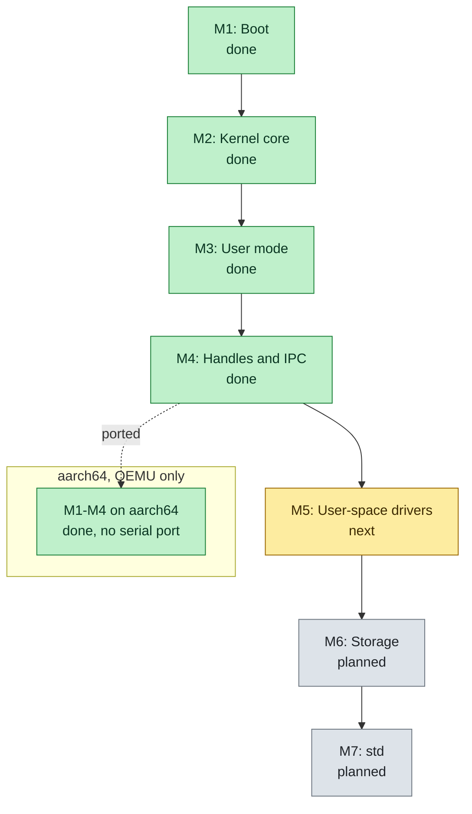

# ThisOS

ThisOS is a general-purpose operating system written in Rust, built on a microkernel. The kernel manages memory, threads, interrupts, handles and IPC. Drivers, filesystems and other services are to run as isolated user-space programs that reach only what they were handed. It runs on 64-bit hardware, starting with x86_64, and programs will target Rust's standard library. It has no libc and is not Unix-like.

## Status

The design for the first milestones is settled. Milestones 1 to 4 are done on x86_64, in QEMU and on the test laptop: the kernel boots, runs user programs in address spaces of their own, and gives them handles, channels and shared memory. Next is milestone 5 (user-space drivers). aarch64 runs in QEMU only, behind x86_64 ([ADR 0006](docs/adr/0006-aarch64-behind-x86_64.md)), with milestone 4's parity except that it has no serial port.

- [docs/design.md](docs/design.md) describes the system and its milestones.
- [docs/adr/](docs/adr/) holds the decisions that are hard to reverse.
- [CONTRIBUTING.md](CONTRIBUTING.md) says how code is written, tested and decided.

## Milestones

Each milestone ends with QEMU and the laptop doing something they couldn't before.

M1: Boot (done)

The workspaces and xtask. The kernel boots under UEFI in QEMU and on the test laptop, logs to serial and a framebuffer console, prints a backtrace when it panics, and runs its tests in QEMU, in CI and on the laptop.

Decisions: [ADR 0001](docs/adr/0001-kernel-scope.md).

M2: Kernel core (done)

The kernel loads its own GDT, TSS and IDT and reports any trap with its registers and a backtrace, allocates physical frames from the memory map, runs on page tables of its own with a heap, and ticks a LAPIC timer whose watchdog stops a hung test. One laptop flash runs every kernel test.

Decisions: [ADR 0005](docs/adr/0005-banned-patterns.md).

M3: User mode (done)

Kernel threads with guarded stacks, preempted round robin on every tick; user address spaces; and syscall entry through SYSCALL. The kernel loads `init` from the ramdisk as an ELF file and runs it in ring 3, where it prints through a write syscall and exits.

Decisions: [ADR 0007](docs/adr/0007-syscall-abi-x86_64.md).

M4: Handles and IPC (done)

Blocking in the scheduler; a handle table per process, with rights, duplicate and restrict; memory objects that user code maps, with W^X held across every mapping of an object; channels carrying bytes and handles; a wait call on several objects; the page-table code's raw-pointer walks under Miri on the host; syscalls that build a process from user space, with a ramdisk of several programs; and a log that a kernel thread draws from a ring once the kernel is up, so that code that logs doesn't wait for the serial port with interrupts off.

`init` loads `hello`, `fault`, `ping` and `pong` from the ramdisk and reports how each ended. `ping` and `pong` talk over a channel, and on the test laptop a 16-byte round trip between them takes 1.7 µs.

Decisions: [ADR 0002](docs/adr/0002-handles.md), [ADR 0003](docs/adr/0003-ipc-channels.md), [ADR 0004](docs/adr/0004-process-creation.md), [ADR 0008](docs/adr/0008-memory-objects.md), [ADR 0009](docs/adr/0009-process-building.md).

M1-M4 on aarch64 (done)

The kernel runs on QEMU's virt machine with the same HAL as on x86_64, and passes the same QEMU tests, which CI runs after x86_64's. There is no serial port, so the kernel logs to the framebuffer alone. Work lands on x86_64 first, and aarch64 gains a feature when its port is scheduled. See [design.md, aarch64](docs/design.md#aarch64).

Decisions: [ADR 0006](docs/adr/0006-aarch64-behind-x86_64.md), [ADR 0010](docs/adr/0010-syscall-abi-aarch64.md).

M5: User-space drivers (next)

Interrupts delivered to user space; handles for MMIO and I/O port ranges; serial and i8042 keyboard drivers in user space; a shell that runs programs from the ramdisk. The name and API of the audited driver crate are still open. See [design.md, User-space drivers](docs/design.md#user-space-drivers).

M6: Storage (planned)

PCI enumeration in user space, an NVMe driver, a filesystem server and a namespace protocol.

M7: std (planned)

A std platform-layer patch over the ABI as it stands then, giving `std::{io, fs, env, process, thread, time}`. Before it, the kernel has to save FP and SIMD state per thread ([ADR 0007](docs/adr/0007-syscall-abi-x86_64.md), [ADR 0010](docs/adr/0010-syscall-abi-aarch64.md)).

## License

ThisOS is licensed under either of the [MIT license](LICENSE-MIT) or the [Apache License, Version 2.0](LICENSE-APACHE), at your option.

Unless you explicitly state otherwise, any contribution intentionally submitted for inclusion in ThisOS by you, as defined in the Apache-2.0 license, shall be dual licensed as above, without any additional terms or conditions.
